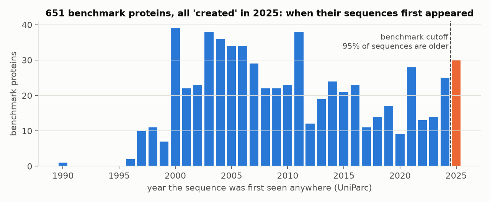
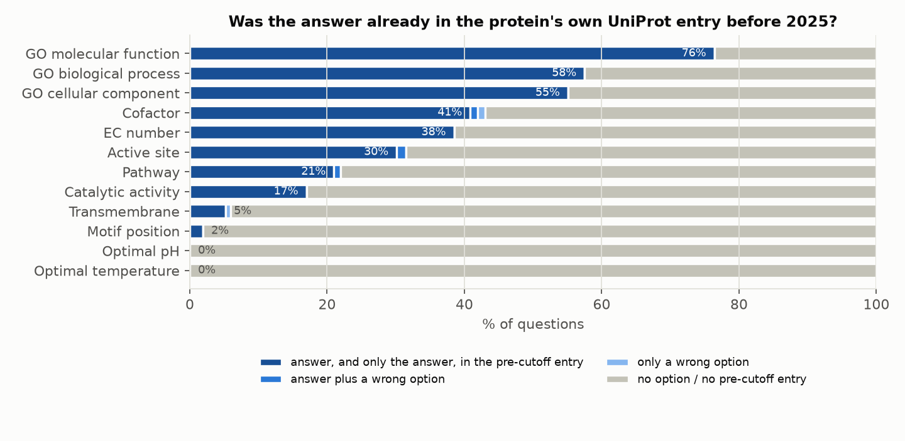
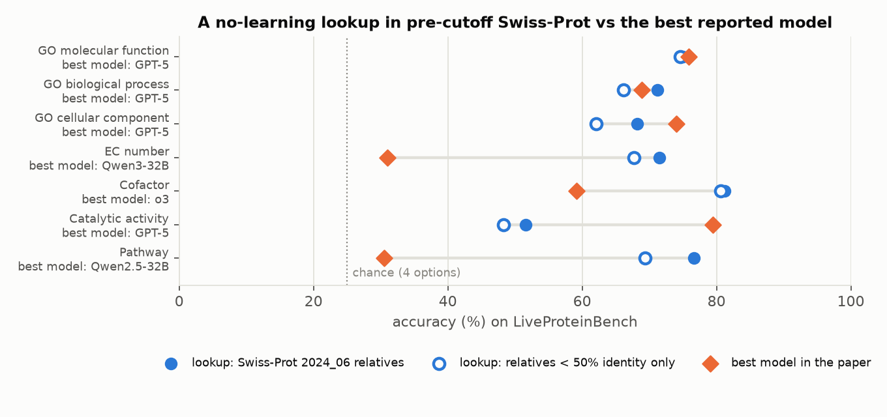
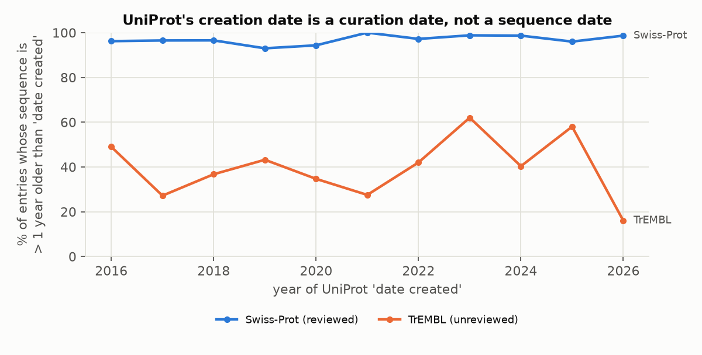
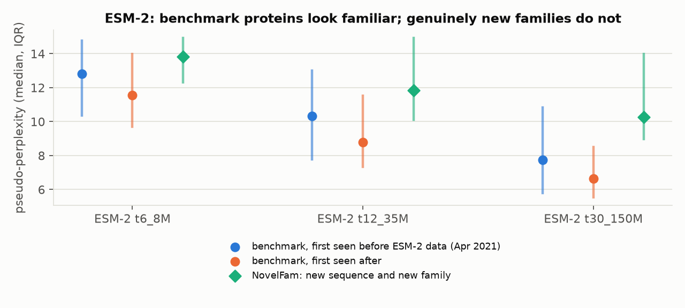

# protein-cutoff-audit

[](https://github.com/aarnavbhat23/protein-cutoff-audit/actions/workflows/tests.yml)

Temporal cutoffs are becoming the standard defence against contamination in scientific benchmarks: evaluate only on data "released after" a model's training date. For proteins, the date that gets used is UniProt's `date created`. **That date says when an entry was curated, not when the protein became known.**

This repository measures what that does, at three levels:

1. **The rules.** For the two published protein benchmarks that select by UniProt date, we rebuild each rule's full candidate pool and date every sequence.
2. **One benchmark in full.** [LiveProteinBench](https://arxiv.org/abs/2512.22257) describes itself as contamination-free because every protein was "first publicly released after January 1, 2025". We audit all **1,797 questions on 651 proteins**, pinned to commit [`8b97109`](https://github.com/Rongdingyi/LiveProteinBench/tree/8b9710932511f816651fc1a7e8a1bc85c3c77767), against UniProt's own archives.
3. **The models.** We test whether protein language models treat "post-cutoff" proteins as new.

**Date-based selection rules mostly select old proteins.** Reviewed UniProtKB entries (50–1,022 aa) with `date_created` on or after the cutoff:

| Rule | Entries | Sequence first seen before cutoff | More than 1 year before | Median first seen | UniRef50 cluster has a pre-cutoff member (sample) |
|---|---:|---:|---:|---:|---:|
| created ≥ 2025-01-01 ([LiveProteinBench](https://arxiv.org/abs/2512.22257)) | 2,743 | **93.9%** | 92.7% | May 2010 | 90.3% (n=559) |
| created ≥ 2025-09-01 ([VibeProteinBench](https://arxiv.org/abs/2605.10978), "registered after September 1, 2025"; data not released) | 1,834 | **95.6%** | 94.6% | Apr 2010 | 91.6% (n=526) |



## What we found

| Check | Result |
|---|---:|
| Proteins whose first Swiss-Prot version is ≥ 2025 (the date the benchmark used) | **100%** |
| Sequence first seen anywhere (UniParc) before the cutoff | **95.4%** |
| … before 2015 / before 2010 | 68.5% / 50.7% (median: July 2009) |
| Same accession already public in UniProtKB/TrEMBL before the cutoff | **89.1%** |
| UniRef50 cluster contains a protein created before the cutoff | **92.9%** (median 22 such members) |
| Every PubMed paper cited by the current entry predates the cutoff | **93.2%** (median newest citation: Aug 2021) |
| Questions whose correct option, and no wrong option, is in the protein's **own pre-2025 entry** | **36.1%** (649 / 1,797) |
| Accuracy of a no-learning lookup in **Swiss-Prot 2024_06** (7 annotation tasks, 1,370 questions; chance 25%) | **70.7%** |
| … using only relatives below 50% identity | 66.8% |
| Questions on proteins whose sequence *and* 50% family are new at the cutoff | **4 (0.2%)** |

The date that defines the benchmark is when each protein reached Swiss-Prot curation. In 2025 that was typically 15–20 years after the sequence, its unreviewed entry, its annotations and its literature were public.



**The answer was often already in the protein's own entry.** For each protein we fetch the last UniProtKB version released before 2025-01-01 from UniSave, UniProt's entry archive. For Q8MVC4, the November 2024 TrEMBL entry already carried the benchmark's correct answer (`GO:0004867 serine-type endopeptidase inhibitor activity`), and its function paper dates from 2004. Leakage is highest for GO molecular function (76%) and lowest for the experimental pH and temperature optima (0%), which TrEMBL does not carry.



**Pre-cutoff relatives answer most questions.** A lookup with no learning searches each protein against Swiss-Prot release 2024_06 (27 Nov 2024) with MMseqs2. It picks the option best supported by the annotations of relatives at ≥ 30% identity. It beats the best model in the paper on EC number (71.5% vs 31.0%), pathway (76.6% vs 30.5%) and cofactor (81.2% vs 59.1%). It roughly ties GPT-5 on the GO tasks, and trails it on catalytic activity, where our exact-reaction matching is strict. When a relative supports an option, that option is correct 97–100% of the time.

Annotation transfer from homologs is a legitimate method, not cheating. The point is narrower: **a date cutoff does not make the questions new.** The benchmark largely measures recall of family-level knowledge that predates its cutoff.



**It is not specific to this benchmark.** In samples of Swiss-Prot entries created in each year from 2016 to 2026, 93–100% have sequences more than a year older than their creation date. The median gap has grown from 13 years (2016) to 22 years (2026). Any "created after" filter on reviewed UniProt entries inherits this.



**Protein language models find these proteins familiar, and more so as they grow.** ESM-2 was trained on UniRef 2021_04. We estimate its pseudo-perplexity from 64 masked positions per protein for every benchmark protein and for the 64 NovelFam proteins (new sequence and new 50% family, no Swiss-Prot relative; `data/novelfam/`). This ran on a Colab T4 using `notebooks/esm2_colab_standalone.py`.

| ESM-2 | first seen before Apr 2021 (n=541) | after (n=110) | NovelFam (n=64) | length-adjusted ratio vs NovelFam: before / after |
|---|---:|---:|---:|---:|
| 8M | 12.81 | 11.55 | 13.84 | 0.90 [0.85, 0.95] / 0.86 [0.80, 0.92] |
| 35M | 10.32 | 8.79 | 11.84 | 0.82 [0.76, 0.88] / 0.75 [0.68, 0.82] |
| 150M | 7.76 | 6.63 | 10.28 | **0.75** [0.68, 0.82] / **0.66** [0.59, 0.74] |

Medians; ratios from a log-linear fit on length with 95% bootstrap intervals. Two observations:

- Benchmark proteins are 10–34% easier for ESM-2 than genuinely new families, and the gap widens with model size.
- Whether ESM-2 saw the *exact* sequence does not matter: proteins first seen after its training data are slightly *easier* (median difference +1.1 to +1.5, all intervals above zero).

What makes them predictable is that their families were known, which matches the 92.9% with pre-cutoff relatives. Caveat: NovelFam is dominated by short venom peptides and other unusual proteins, so protein type, not only novelty, may explain part of its higher perplexity.

**A matched test removes the protein-type confound.** From the same 2024–26 UniProt additions we take proteins whose sequence was first seen on or after 2023-01-01, so none can be in ESM-2's data. We split them by whether their UniRef50 family is new (n=157) or old (n=314, matched 2:1 on length and review status; `data/matched_family_novelty.tsv`, `notebooks/esm2_colab_matched.py`):

| ESM-2 | new family | old family | length-adjusted ratio old / new |
|---|---:|---:|---:|
| 8M | 13.64 | 12.56 | 0.93 [0.89, 0.98] |
| 35M | 10.88 | 9.28 | 0.89 [0.84, 0.95] |
| 150M | 9.11 | 7.06 | **0.81** [0.76, 0.87] |

Sequences never seen by ESM-2 are still up to 19% easier when their family was known, and the effect grows with model size. Homology-driven likelihood in protein LMs is known ([Gordon et al., ICLR 2025](https://proceedings.iclr.cc/paper_files/paper/2025/file/62cf81a87f367758cebabce08e8d40d8-Paper-Conference.pdf)). What this adds is the evaluation consequence: **a cutoff on sequence dates does little to control what a protein LM finds familiar; a family-level (cluster) cutoff is what matters.**

## A cleaner subset

`results/clean_subset.tsv` flags every question (by id) through four nested filters:

| Filter | Questions left |
|---|---:|
| All | 1,797 |
| Answer not supported by the protein's own pre-cutoff entry | 1,142 |
| … and no Swiss-Prot 2024_06 relative supports any option (annotation tasks) | 780 |
| … and the sequence was first seen after the cutoff | 28 |
| … and its UniRef50 cluster has no member created before the cutoff | 4 |

A benchmark that wants genuinely unseen proteins has to be built from new sequences and new families. As our [NovelFam](https://github.com/aarnavbhat23/next-token-bio) build shows, that pool is small: 64 of 10,127 recently created UniProt entries survived the same filters.

## Use it on your own data

```bash
printf "Q8MVC4\nP0DXN9\n" | python -m cutoffaudit.seqdate --cutoff 2025-01-01 -
```

| verdict | meaning |
|---|---|
| `old_sequence` | UniParc first saw the sequence before the cutoff |
| `new_sequence_old_family` | new sequence, but its UniRef50 cluster has a member created before the cutoff |
| `new` | sequence and its 50% neighbourhood are new |

## Method

- **Dates.** UniParc `first_seen` (when the sequence first appeared in any source database), UniSave entry histories (first UniProtKB version, first Swiss-Prot version, sequence-version changes), and a count of UniRef50 cluster members created before the cutoff.
- **Own-entry leakage.** One matcher per task compares each option with the specific annotation the question is about. The annotations are: GO terms of the right aspect, EC numbers, `COFACTOR` names, `CATALYTIC ACTIVITY` reactions, `PATHWAY` text or keywords, `ACT_SITE` / `MOTIF` / `TRANSMEM` locations, and the stated pH and temperature optima. A question counts as leaked only if the correct option is supported and no wrong option is.
- **Calibration.** Run on the *current* entries, the same matchers find the correct option alone for 86.9% of questions and flag a wrong option alone for 0.06%. So they are precise, and their recall bounds the leakage numbers from below.
- **Relatives baseline.** MMseqs2 `-s 7.5`, E < 1e-3, ≥ 30% identity over ≥ 50% of the query, top 10 relatives, options scored by the best supporting identity, ties split, no support = uniform guess. Positional and numeric tasks are excluded: active site, motif and transmembrane would need coordinates mapped through the alignment, and pH and temperature optima are rarely annotated.
- **Literature.** Publication dates of every PubMed reference in the current entry (NCBI E-utilities).

## Limits

- This shows that the information **was public** before the cutoff. It cannot show that any particular model **was trained on** it; model training sets are not disclosed.
- The matchers are exact. Paraphrased or renamed annotations are missed, so leakage is a lower bound (calibration recall: 69% for GO biological process, 72% for catalytic activity).
- The matched test's length matching is imperfect (median 260 vs 339 aa); the ratios are length-adjusted. New families are still enriched for small toxins and peptides, so residual protein-type differences remain.
- The survey samples the first page of each month's results (≤ 50 entries), so the TrEMBL series in particular is noisy.
- UniParc dates the sequence, not the protein's characterisation. A new sequence can still belong to a well-studied family, which is why the cluster check is reported separately.

## Prior work and credit

- **LiveProteinBench:** Rong et al., [arXiv:2512.22257](https://arxiv.org/abs/2512.22257), [code and data](https://github.com/Rongdingyi/LiveProteinBench). This audit uses their released questions and reported accuracies (their Table 2) and does not redistribute their files.
- **Related concerns:** a [secondary summary](https://www.emergentmind.com/topics/contamination-free-rolling-benchmark) noted that a post-2025 timestamp "does not logically exclude earlier homologous information". Benchmark audits such as the [biomolecular benchmark audit](https://pubs.rsc.org/sc/article/doi/10.1039/d6sc01799a/1285850/Auditing-widely-used-biomolecular-benchmarks) and work on [leakage in protein–ligand benchmarks](https://www.biorxiv.org/content/10.64898/2026.06.29.735309v1) study split contamination.

  We found no prior quantitative audit of UniProt-date cutoffs using sequence first-seen dates and entry histories. If one exists, please open an issue.
- **Protein-LM likelihood and homology:** Gordon, Lu & Abbeel, [ICLR 2025](https://proceedings.iclr.cc/paper_files/paper/2025/file/62cf81a87f367758cebabce08e8d40d8-Paper-Conference.pdf) (influence of homologous training sequences); Ding & Steinhardt, ICLR 2024 (sampling bias across the tree of life). Our ESM-2 results are consistent with and build on these.
- **Data:** [UniProt](https://www.uniprot.org) (UniProtKB, UniParc, UniRef, UniSave; CC BY 4.0), NCBI PubMed E-utilities, [MMseqs2](https://github.com/soedinglab/MMseqs2).

## Reproduce

Python 3.12+ with NumPy and matplotlib; `mmseqs` for the relatives baseline; `fair-esm` and PyTorch for the optional protein-LM check. All HTTP responses are cached under `data/cache/`.

```bash
python -m unittest discover -s tests -v
python -m cutoffaudit.audit all        # dates + own-entry leakage + calibration  -> results/proteins.tsv, items.tsv, summary.json
python -m cutoffaudit.literature       # -> results/literature.*
python -m cutoffaudit.survey           # -> results/survey.json
python -m cutoffaudit.ruleaudit        # -> results/rules.json (both benchmarks' selection rules)
./scripts/fetch_sprot_2024_06.sh       # ~1.7 GB download, keeps uniprot_sprot.dat.gz (680 MB)
python -m cutoffaudit.homolog all      # index, MMseqs2 search, score, sensitivity
python -m cutoffaudit.subset
# ESM-2 check: run notebooks/esm2_colab_standalone.ipynb on a Colab GPU (self-contained; ~45 min on a T4)
python -m cutoffaudit.report           # figures + results/summary.md
```

Code: MIT. Every number comes from the files in `results/`. There is no independent review or adoption claim.
